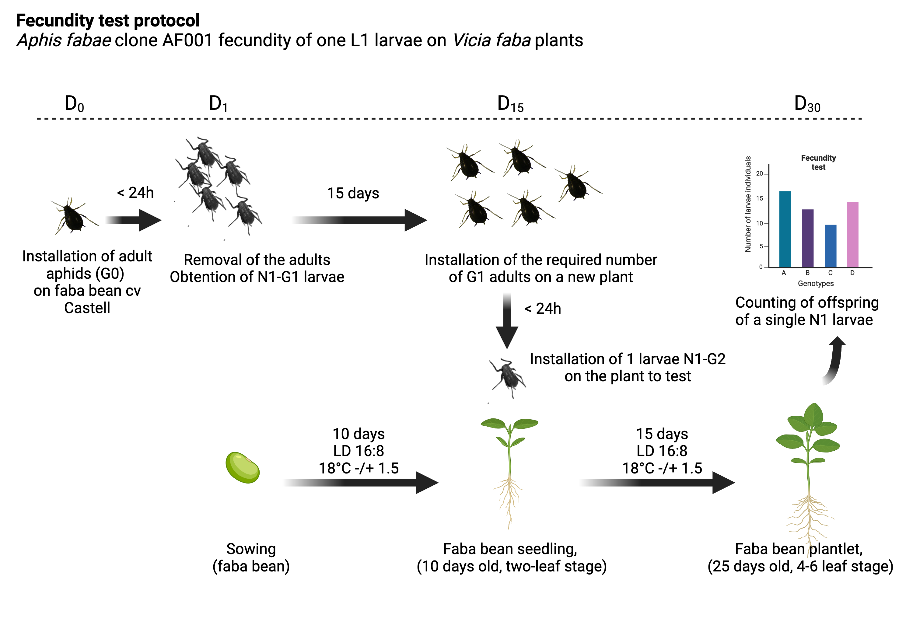

# Aphid fecundity test results (SPECIFICS 251 genotypes large screen)

[FIXME] Description of the fecundity test

[FIXME] Description of the clones

## Aphid fecundity test

Illustrated here for _Aphis fabae_ but same for _Acyrthosiphon pisum_. 

## Data dictionary 

- genotype: short code used for practical ease of use in experiments (1 to 251).     
- seed_batch: the seed lot used in the experiment (from own greenhoue multiplication).   
- ivip: seed stock number accession identifier.   
- aphid: aphid species and clone used in experiment. 
- tray_id: number of the tray on which plants were grown.   
- rep: plant individual replicate number (biological replicate).  
- session: experimental batch (corresponds to a different time period, one experiment per month approx.).  
- climate_chb: identifier of the growth chamber
- age_plant: age of the faba bean plant in days.  
- start_date: start date of the experiment (installation date).
- end_date: end date of the experiment (total offspring count) 
- adult_alive: number of adults alive seen on the plant.  
- adult_winged: number of winged adult seen on the plant. 
- larvae_total_number: total number of larvae (all apterous stage) counted visually from one single G2-L1 larvae.  

NA: data non-available. 

**Additional explanations**

| Column        | Values / data types                   | Explication                                                                      |
|---------------|---------------------------------------|----------------------------------------------------------------------------------|
| genotype      | 1 to 251                              | short code used                                                                  |
| seed_batch    | KF…. / JF…. / german_batch            | seed lot used in experiment (IGEPP INRAE id) or Jena (MPI-CE, Germany)           |
| ivip          | IVIP10…., NA                          | INRAE seed stock identifier (Dijon, CRG)                                         |
| aphid         | A.pisum clone P123 or A. fabae AF001  | aphid species and clone                                                          |
| tray_id       | 1 to 17                               | tray number used to place the pots with plants                                   |
| session       | a to g, NA                            | experimental batch (time period)                                                 |
| climate_chb   | 131, 132, 135, NA                     | growth chamber number used in experiments                                        |
| rep           | 1 to 13, NA                           | biological replicate per genotype                                                |
| faba_age      | integers, 10 to 19 days, NA           | faba bean age (days) on the day of L1 larvae installation                        |
| start_date    | date                                  | start date of the experiment (L1 larvae installation date)                       |
| end_date      | date                                  | end date of the experiment (total offspring count)                               |
| adult_alive   | 0, 1, NA                              | adulte alive (1) or dead (0)                                                     |
| adult_winged  | 0, 1, NA                              | winged adult (1) or apterous (0)                                                 |
| larvae_total_number   | integers, NA                  | total number of larvae (all apterous stage) counted visually                     |

