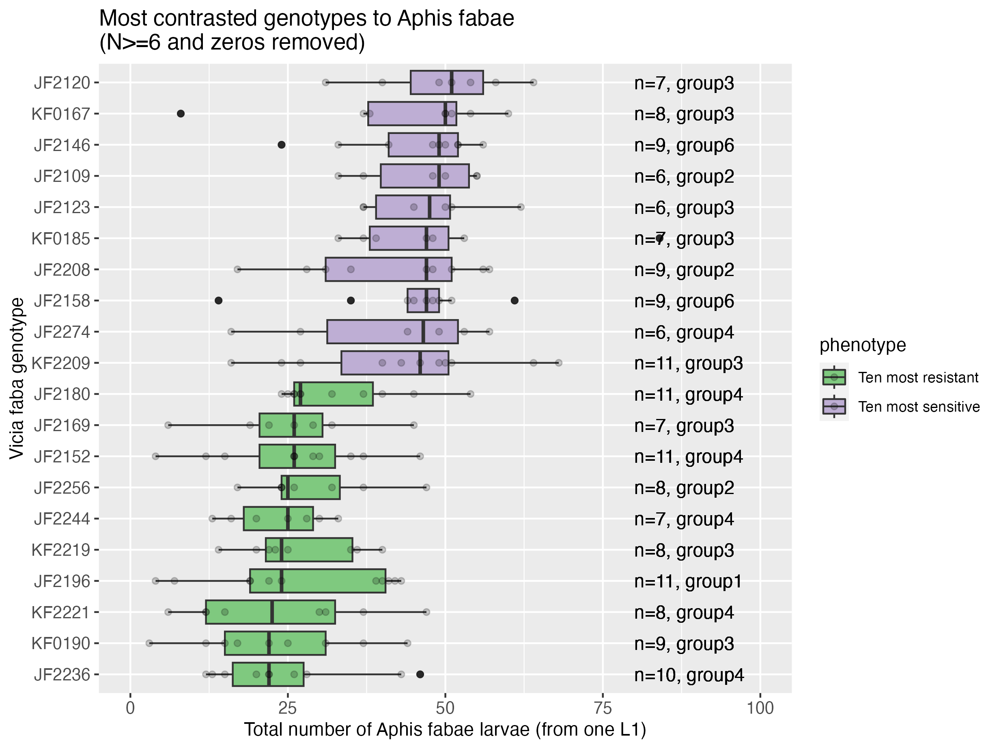

# README P2-XP002 fecundity counts Aphis fabae AF001 on most sensitive and resistant

__Important:__ the L1 larvae were placed in a climate chamber (53 LP 332) in the basement of building 320 at IGEPP that was set at 18°C -/+ 0.5 consistently with the temperature of climate chamber in building 345.
Problem is that the temperatures of the growth chambers in building 345 are closer to 20°C and not 18°C. We realised this after a week so we switched back the temperature to 20 -/+0.5 degrees. 

## Objective 

The 10 most sensitive and 10 most resistant genotypes of Vicia faba identified in the 2024 screen (see `01.data/02.aphis_fabae_on_faba_collection/` and `02.analyses/02.aphis_fabae_on_faba_collection/01_analysis1...`) were chosen to be confirmed within the same experiment. Indeed, a considerable batch effect was observable.  

## Protocol

### L1 larvae aphid rearing

AF001 is a clone of _Aphis fabae_, retrieved at IGEPP in the experimental garden (maintained by Loic).  

- Step 1: G0 adults were transferred on Castell faba bean plants for 24h to obtain several single one-day old L1 larvae (G1-L1).   
- Step 2: these G1-L1 larvae developped into adults (G1-adults) during approx. 15 days at 18-/+ 1.5 degrees.   
- Step 3: these G1-adults were transfered for 24h on new faba Castell plants to obtain G2-L1 larvae.
- Step 4: one L1 larvae was placed on each plant for 15 days.   

## Plants 

The 10 most sensitive and 10 most resistant genotypes to Aphis fabae AF001 of _Vicia faba_ identified in the 2024 screen were chosen to be confirmed within the same experiment. 

## Data dictionary

- short_code: Maiwenn's short genotype code.   
- aphid: aphid species and clone.  
- phenotype_class_p123: resistance class as infered from previous results (see figure above) from the main 251 screen.   
- genotype: seed batch number (from IGEPP RD team)  
- replicate: plant replicate.  
- adult_alive: number of adults alive seen on the plant.  
- adult_winged: number of winged adult seen on the plant. 
- larvae_total_number: total number of larvae (all apterous stage )
- comment: optional free-text comments. 

