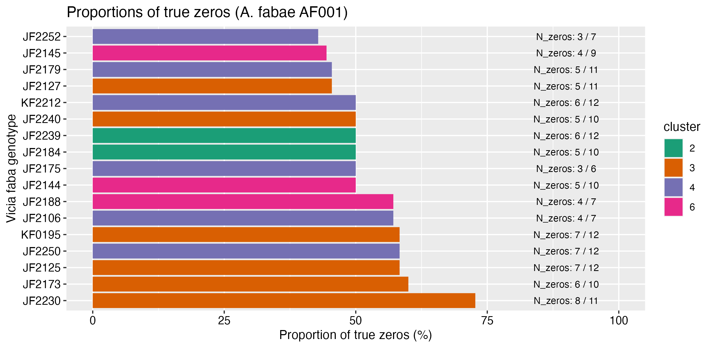

# README P2-XP003 survival assay Aphis fabae AF001 larvae 

## Objective 

Some faba bean genotypes showed a lot of "0" for the total number of larvae obtained from one single L1-G2 larvae of Aphis fabae AF001.

The goal is to estimate the number of surviving adults from a small number of larvae (10) after 9 days. The offspring (larvae number) will also be counted. 

## Protocol

### L1 larvae aphid rearing

AF001 is a clone of _Aphis fabae_, retrieved at IGEPP in the experimental garden (maintained by Loic).  

- Step 1: G0 adults were transferred on Castell faba bean plants for 24h to obtain several single one-day old L1 larvae (G1-L1).   
- Step 2: these G1-L1 larvae developped into adults (G1-adults) during approx. 15 days at 18-/+ 1.5 degrees.   
- Step 3: these G1-adults were transfered for 24h on new faba Castell plants to obtain G2-L1 larvae.
- Step 4: 10 L1 larvae was placed on each plant for 9 days.   

## Plants 

The 5 genotypes with the highest proportions of "0" (no larvae counted, see plot) identified in the 2023 SPECIFICS screen (N=251 genotypes) were selected: 
- JF2125 (short code 51)    
- JF2173 (short code 115)  
- JF2250 (short code 214)  
- KF0195 (short code 217)  
- JF2230 (short code 187)  

10 seeds were sown per genotype and they were grown during 15 days at 20 degrees and in long days (16/8 D/N).

## Data dictionary

- short_code: Maiwenn's short genotype code.   
- aphid_species: aphid species and clone.   
- genotype: seed batch number (from IGEPP RD team).    
- replicate: plant replicate.  
- adult_alive: number of adults alive seen on the plant (from 10 larvae installed).  
- adult_winged: number of winged adult seen on the plant. 
- larvae_total_number: total number of larvae (all apterous stages).    
- number_nodes: number of plant nodes (useful to estimate plant developmental stage).   
- comment: optional free-text comments. 

