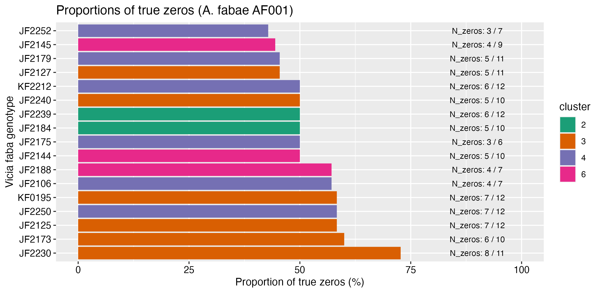

# P2-XP005 survival assay of Aphis fabae AF001 larvae with controls

## Objective 

Some faba bean genotypes showed a lot of "0" for the total number of larvae obtained from one single L1-G2 larvae of Aphis fabae AF001.  

The goal is to estimate the number of surviving adults from a small number of larvae (10) after 9 days. The offspring (larvae number) will not be counted. Additional controls will be added compared to the previous experiment. 

## Protocol

### L1 larvae aphid rearing

AF001 is a clone of _Aphis fabae_, retrieved at IGEPP in the experimental garden (maintained by Loic).  

- Step 1: G0 adults were transferred on Castell faba bean plants for 24h to obtain several single one-day old L1 larvae (G1-L1).   
- Step 2: these G1-L1 larvae developped into adults (G1-adults) during approx. 15 days at 18-/+ 1.5 degrees.  
- Step 3: these G1-adults were transfered for 24h on new faba Castell plants to obtain G2-L1 larvae.
- Step 4: 10 L1 larvae was placed on each plant for 9 days.   

## Faba plant genotypes to sow

The 5 genotypes with the highest proportions of "0" (no larvae counted, see plot) identified in the 2023 SPECIFICS screen (N=251 genotypes) were selected: 
- JF2125 (short code 51)    
- JF2173 (short code 115)  
- JF2250 (short code 214)  
- KF0195 (short code 217)  
- JF2230 (short code 187)  

Cnotrols (no installation problems)
- JF2128 (short code 60)  
- Castel (féverole)   
- KF0180 (short code 144)   

10 seeds were sown per genotype and they were grown during 15 days at 20 degrees and in long days (16/8 D/N).

## Data dictionary

- short_code: Maiwenn's short genotype code.     
- genotype: IGEPP RD team seed batch code.  
- ivip_code: INRAE Dijon CRB seed bank code.   
- aphid_species_and_clone: aphid species and clone.
- nb_zero_afabae: number of "0" measured out of the total number of replicates in the 2023-2024 SPECIFICS screen of the faba diversity panel with A. fabae (cf plot). Controls (#60 and #144) were choosen for their absence of 0 and Castell was added as it is the faba genotype on which sampled biotypes are installed.        
- start_date: sowing date.  
- measurement_date: date of measure.  
- biol_replicate: plant replicate.  
- nb_N1_larvae_installed: number of N1 apterous larvae from A. fabae installed on the plant.  
- nb_adults_observed: number of adults observed alive (survived from N1 larvae).    

