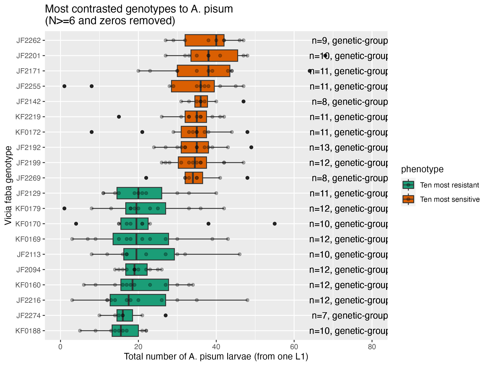

# README P2-XP006 faba vs A. pisum P123 fecundity test

Growth chamber used: L057 132 (after installation up to counting).

## Objective 

The 10 most sensitive and 10 most resistant genotypes of Vicia faba identified in the 2024 screen (see `01.data/01.acyrthosiphon...` and `02.analyses/01.acyrthosiphon.../01_analysis1`) were chosen to be confirmed within the same experiment. Indeed, a considerable batch effect was observable in the big screen performed on the 251 genotypes in 2022-2023.  
Once the most contrasted genotypes are confirmed, they can be further investigated in follow-up experiments. 

## Protocol

### L1 larvae aphid rearing

P123 is a clone of _Acyrtosiphon pisum_ from the pea biotype (cf Ollivier et al. 2022 TAG).  

- Step 1: G0 adults were transferred on Castell faba bean plants for 24h to obtain several single one-day old L1 larvae (G1-L1).   
- Step 2: these G1-L1 larvae developped into adults (G1-adults) during approx. 15 days at 18-/+ 1.5 degrees.   
- Step 3: these G1-adults were transfered for 24h on new faba Castell plants to obtain G2-L1 larvae.
- Step 4: one L1 larvae was placed on each plant for 15 days.   

## Plants 

The 10 most sensitive and 10 most resistant genotypes of _Vicia faba_ identified in the 2024 screen (see `01.data/01.acyrthosiphon...` and `02.analyses/01.acyrthosiphon.../01_analysis1`) were chosen to be confirmed within the same experiment. 

## Stats to apply

GLMM with negative binomial distribution

Multcomp posthoc with glht.

## Data dictionary

- short_code: Maiwenn's short genotype code.   
- aphid: aphid species and clone.  
- phenotype_class_p123: resistance class as infered from previous results (see figure above) from the main 251 screen.   
- genotype: seed batch number (from IGEPP RD team)  
- replicate: plant replicate.  
- adult_alive: number of adults alive seen on the plant.  
- adult_winged: number of winged adult seen on the plant. 
- larvae_total_number: total number of larvae (all apterous stage )
- comment: optional free-text comments. 

# Reference 

Ollivier, R., Glory, I., Cloteau, R. et al. A major-effect genetic locus, ApRVII, controlling resistance against both adapted and non-adapted aphid biotypes in pea. Theor Appl Genet 135, 1511–1528 (2022). https://doi.org/10.1007/s00122-022-04050-x