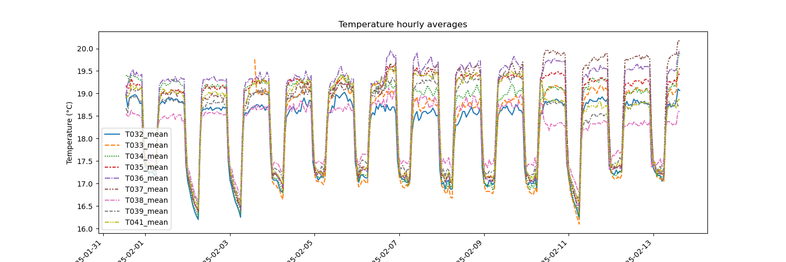
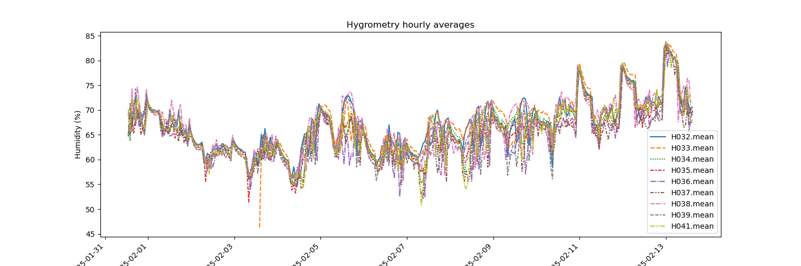

# P2-XP009 third confirmation Aphis fabae

Experiment conducted in chamber 123 (building 345). 

## Genotypes

Decision was made to remove IVIP101799 (Winter) and IVIP100887 (South America) since no PR (Partially Resistant) genotype is present in the same genetic group.

**Final list of genotypes to test**  


|  short_code |  seed_batch | ivip        | cluster_name  | cluster_number  |
|-------------|-------------|-------------|---------------|-----------------|
| 52          |  KF0167 	|  IVIP100376 | South         | 3               |
| 7   		  |  PF0755		|  IVIP100123 | North         | 4               |
| 49  		  |  PF0759 	|  IVIP100355 | South         | 3               |
| 58  		  |  KF2209 	|  IVIP100390 | South         | 3               |
| 88 		  |  JF2152 	|  IVIP100947 | North         | 4               |
| 189 		  |  KF0190 	|  IVIP102198 | South         | 3               |
| 198 		  |  PF0775 	|  IVIP102302 | North         | 4               |
| 224 		  |  PF0781 	|  IVIP102547 | South         | 3 	            |

Plus Hedin /2 (seed batch KF2229) to assess its resistance/sensitivity. 

Note: Hedin /2 could not be included as no seeds were available.  

## Remote temperature and sensors

Positions (sensor number) are indicated below. They are in the right part of the chamber. 

**Wall**  

| Left  | Left  | Middle  | Middle  | Right  | Right  | 
|-------|-------|---------|---------|--------|--------|
|       |       |         |         | 38   39|      41|
|       |       |         |         |        |        |
|       |       |         |         |        |        |
|       |       |         |         |        |        |
|       |       |         |         | 35   36|      37|
|       |       |         |         |        |        |
|       |       |         |         |        |        |
|       |       |         |         | 32   33|      34|

**Door**  

T032_mean: average temperature of sensor #32.  
T033_mean: average temperature of sensor #33.  
etc.  

H032_mean: average hygrometry of sensor #32.    
H033_mean: average hygrometry of sensor #33.    
etc.  

Plots and hourly averages were generated using the `04.utils/parse_and_plot_sensor_data.ipynb` using the following code: 

```bash
conda activate sklearn 
# Pandas version: 2.2.3
# Numpy version: 2.2.2
# Seaborn version: 0.13.2

python 04.utils/parse_and_plot_sensor_data.py \
       -i 01.data/P2-XP009_afabae_third_confirmation/temperature_hygrometry_P2-XP009_and_P2-XP010.csv \
       -o 01.data/P2-XP009_afabae_third_confirmation/processed_data_temp_hygrometry/
```  
This writes the following files to the selected out directory:   

```bash
-rw-r--r--@ 1 mgalland  staff   222K Feb 17 15:19 hygrometry_hourly_average.png
-rw-r--r--@ 1 mgalland  staff   246K Feb 17 15:19 temperature_hourly_average.png
-rw-r--r--@ 1 mgalland  staff    43K Feb 17 15:19 temperature_hygrometry_hourly_average.csv
```

## Plots

**Temperature per hour**



**Hygrometry per hour** 

