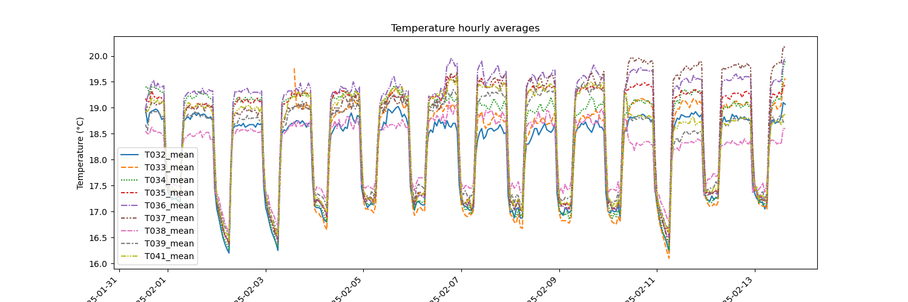
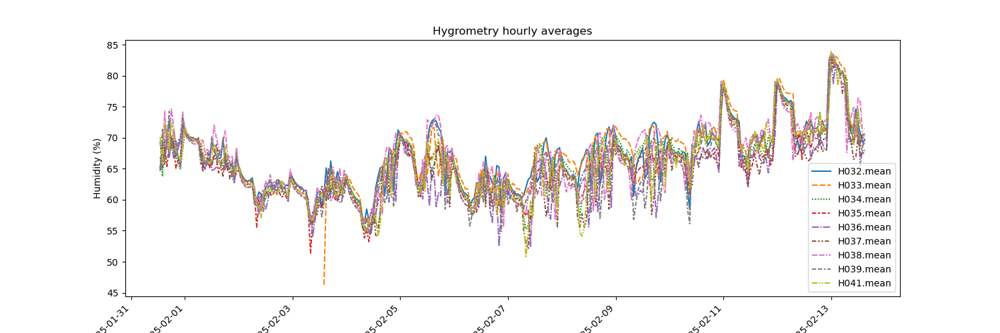

# P2-XP010: third confirmation fedundity test A. pisum  

Experiment conducted in chamber 123 (building 345). 

## Genotypes 

|  short_code |  seed_batch | ivip        | cluster_name          | cluster_number  |
|-------------|-------------|-------------|-----------------------|-----------------|
| 61          |  JF2129 	|  IVIP100396 |   South               | 3               |
| 38   		  |  JF2113		|  IVIP100310 |   North               | 4               |
| 7  		  |  PF0755     |  IVIP100123 |   North               | 4               |
| 57  		  |  KF0170     |  IVIP100388 |   South               | 3               |
| 232 		  |  PF0783     |  IVIP103069 |   North               | 4               |
| 113 		  |  JF2171     |  IVIP101320 |   South               | 3               |
| 77 		  |  PF0761     |  IVIP100872 |   South_America       | 6               |
| 84 		  |  KF0172     |  IVIP100899 |   South_America       | 6               |
| 14 		  |  KF0160     |  IVIP100204 |   Paucijuga           | 1               |
| 170 		  |  KF0188     |  IVIP101957 |   South               | 3               |

We decided to remove all but genotypes from the North and Sourth genetic clusters since no PR (partially resistant) / S (sensitive) pairs could be selected. 

Therefore genotypes #77 (South America), #84 (South America) and #14 (Paucijuga) were removed.

**Final list of genotypes to sow**  

|  short_code |  seed_batch | ivip        | cluster_name          | cluster_number  |
|-------------|-------------|-------------|-----------------------|-----------------|
| 61          |  JF2129 	|  IVIP100396 |   South               | 3               |
| 38   		  |  JF2113		|  IVIP100310 |   North               | 4               |
| 7  		  |  PF0755     |  IVIP100123 |   North               | 4               |
| 57  		  |  KF0170     |  IVIP100388 |   South               | 3               |
| 232 		  |  PF0783     |  IVIP103069 |   North               | 4               |
| 113 		  |  JF2171     |  IVIP101320 |   South               | 3               |
| 170 		  |  KF0188     |  IVIP101957 |   South               | 3               |
## Remote temperature and sensors

Positions (sensor number) are indicated below. They are in the right part of the chamber. 

**Wall**  

| Left  | Left  | Middle  | Middle  | Right  | Right  | 
|-------|-------|---------|---------|--------|--------|
|       |       |         |         | 38   39|      41|
|       |       |         |         |        |        |
|       |       |         |         |        |        |
|       |       |         |         |        |        |
|       |       |         |         | 35   36|      37|
|       |       |         |         |        |        |
|       |       |         |         |        |        |
|       |       |         |         | 32   33|      34|

**Door**  

T032_mean: average temperature of sensor #32.  
T033_mean: average temperature of sensor #33.  
etc.  

H032_mean: average hygrometry of sensor #32.    
H033_mean: average hygrometry of sensor #33.    
etc.  

Plots and hourly averages were generated using the `04.utils/parse_and_plot_sensor_data.ipynb` using the following code: 

```bash
conda activate sklearn 
# Pandas version: 2.2.3
# Numpy version: 2.2.2
# Seaborn version: 0.13.2

python 04.utils/parse_and_plot_sensor_data.py \
       -i 01.data/P2-XP009_afabae_third_confirmation/temperature_hygrometry_P2-XP009_and_P2-XP010.csv \
       -o 01.data/P2-XP010_fabae_pisum_third_confirmation/processed_data_temp_hygrometry/
```  
This writes the following files to the selected out directory:   

```bash
-rw-r--r--@ 1 mgalland  staff   222K Feb 17 15:19 hygrometry_hourly_average.png
-rw-r--r--@ 1 mgalland  staff   246K Feb 17 15:19 temperature_hourly_average.png
-rw-r--r--@ 1 mgalland  staff    43K Feb 17 15:19 temperature_hygrometry_hourly_average.csv
```

## Plots

**Temperature per hour**



**Hygrometry per hour** 


