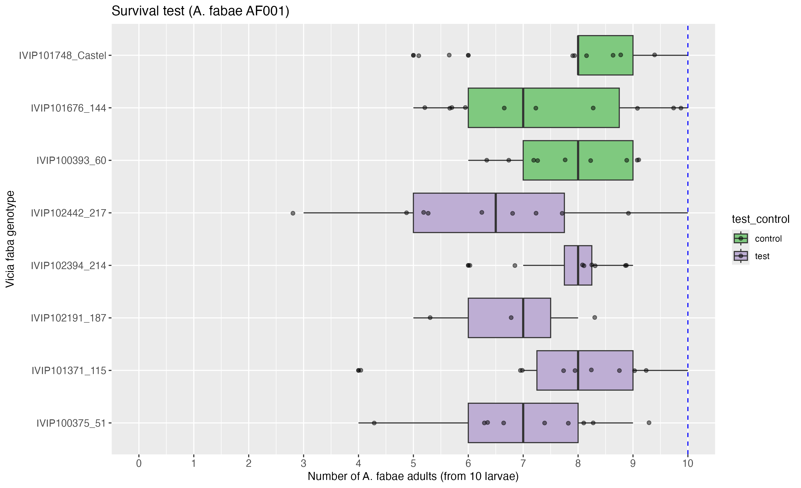

# README

Warning: results not reliable due to a growth chamber temperature that is too low (20°C).

  

**No difference between Castell and the other genotypes (GLM or GLMM).** 

| model | contrast               | null.value | estimate | std.error | df  | statistic | adj.p.value |
| ----- | ---------------------- | ---------- | -------- | --------- | --- | --------- | ----------- |
| GLM   | IVIP100375_51-Castell  | 0          | \-0.17   | 0.167     | Inf | \-1.02    | 0.972       |
| GLM   | IVIP101371_115-Castell | 0          | \-0.0494 | 0.157     | Inf | \-0.314   | 1           |
| GLM   | IVIP102191_187-Castell | 0          | \-0.219  | 0.249     | Inf | \-0.88    | 0.988       |
| GLM   | IVIP102394_214-Castell | 0          | \-0.0526 | 0.167     | Inf | \-0.315   | 1           |
| GLM   | IVIP102442_217-Castell | 0          | \-0.244  | 0.166     | Inf | \-1.48    | 0.821       |
| GLM   | IVIP100393_60-Castell  | 0          | \-0.065  | 0.162     | Inf | \-0.4     | 1           |
| GLM   | IVIP101676_144-Castell | 0          | \-0.115  | 0.16      | Inf | \-0.718   | 0.997       |
|       |                        |            |          |           |     |           |             |
|       |                        | null.value | estimate | std.error | df  | statistic | adj.p.value |
| GLMER | IVIP100375_51-Castell  | 0          | \-0.17   | 0.158     | Inf | \-1.08    | 0.961       |
| GLMER | IVIP101371_115-Castell | 0          | \-0.0494 | 0.157     | Inf | \-0.315   | 1           |
| GLMER | IVIP102191_187-Castell | 0          | \-0.219  | 0.247     | Inf | \-0.886   | 0.987       |
| GLMER | IVIP102394_214-Castell | 0          | \-0.0526 | 0.167     | Inf | \-0.315   | 1           |
| GLMER | IVIP102442_217-Castell | 0          | \-0.244  | 0.164     | Inf | \-1.49    | 0.814       |
| GLMER | IVIP100393_60-Castell  | 0          | \-0.065  | 0.161     | Inf | \-0.405   | 1           |
