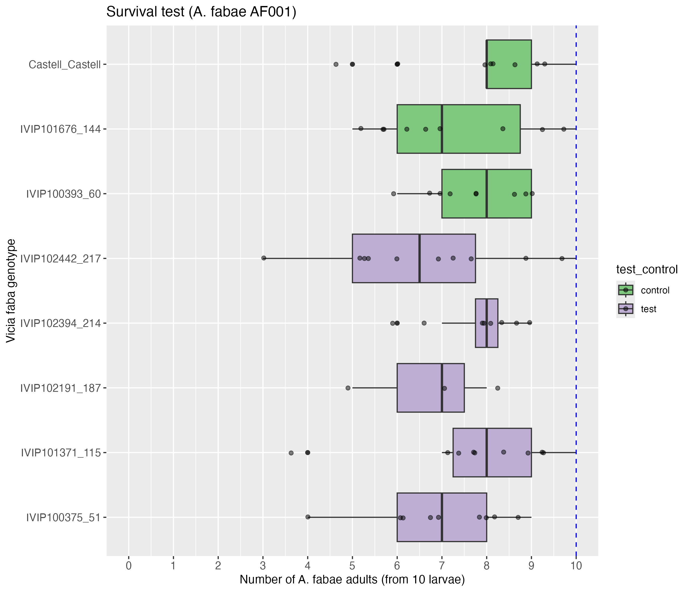

# README

  

**No difference between Castell and the other genotypes (GLM or GLMM).** 

term     contrast                         null.value estimate std.error    df statistic adj.p.value
1 genotype IVIP100375_51 - Castell_Castell           0  -0.170      0.167   Inf    -1.02        0.972
2 genotype IVIP101371_115 - Castell_Castell          0  -0.0494     0.157   Inf    -0.314       1.00 
3 genotype IVIP102191_187 - Castell_Castell          0  -0.219      0.249   Inf    -0.880       0.988
4 genotype IVIP102394_214 - Castell_Castell          0  -0.0526     0.167   Inf    -0.315       1.00 
5 genotype IVIP102442_217 - Castell_Castell          0  -0.244      0.166   Inf    -1.48        0.821
6 genotype IVIP100393_60 - Castell_Castell           0  -0.0650     0.162   Inf    -0.400       1.00 
7 genotype IVIP101676_144 - Castell_Castell          0  -0.115      0.160   Inf    -0.718       0.997

term     contrast                         null.value estimate std.error    df statistic adj.p.value
1 genotype IVIP100375_51 - Castell_Castell           0  -0.170      0.158   Inf    -1.08        0.961
2 genotype IVIP101371_115 - Castell_Castell          0  -0.0494     0.157   Inf    -0.315       1.00 
3 genotype IVIP102191_187 - Castell_Castell          0  -0.219      0.247   Inf    -0.886       0.987
4 genotype IVIP102394_214 - Castell_Castell          0  -0.0526     0.167   Inf    -0.315       1.00 
5 genotype IVIP102442_217 - Castell_Castell          0  -0.244      0.164   Inf    -1.49        0.814
6 genotype IVIP100393_60 - Castell_Castell           0  -0.0650     0.161   Inf    -0.405       1.00 
7 genotype IVIP101676_144 - Castell_Castell          0  -0.115      0.158   Inf    -0.726       0.996