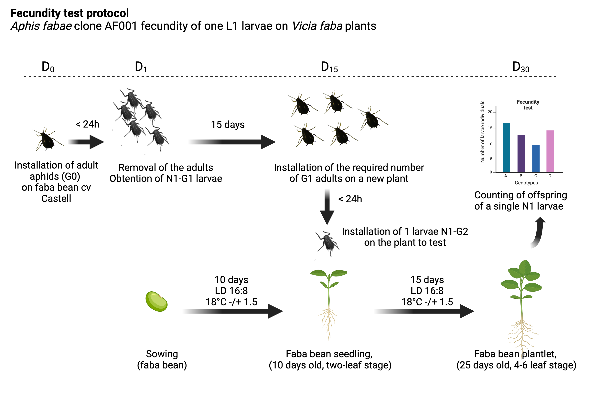
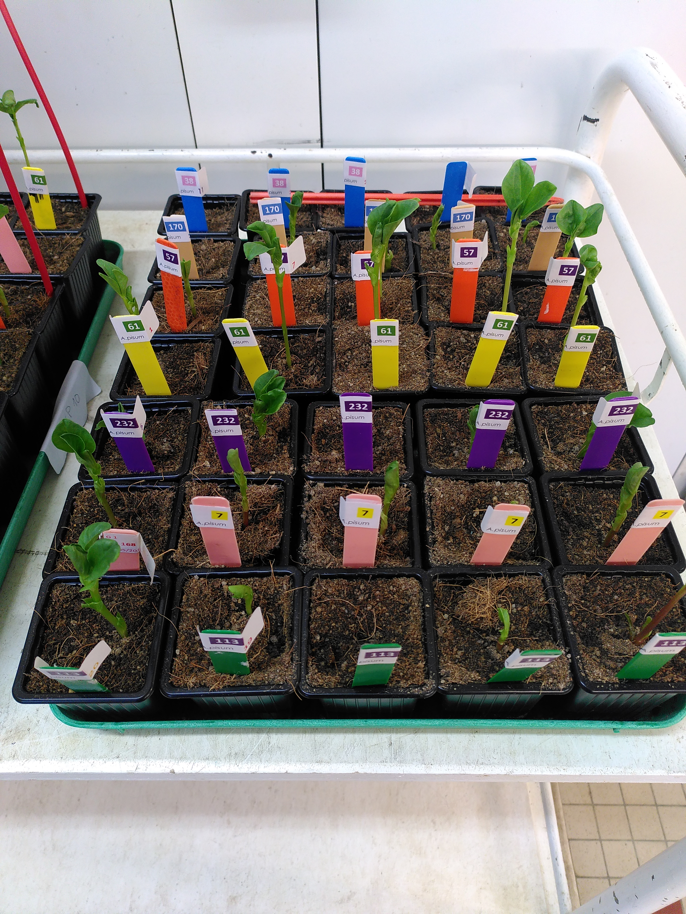
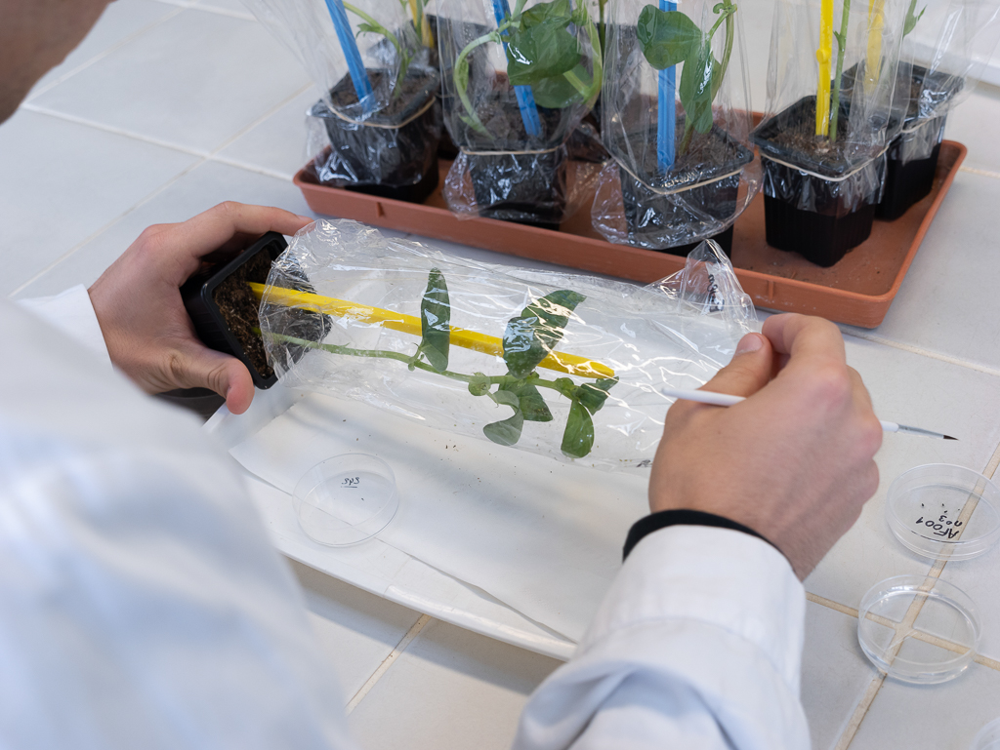
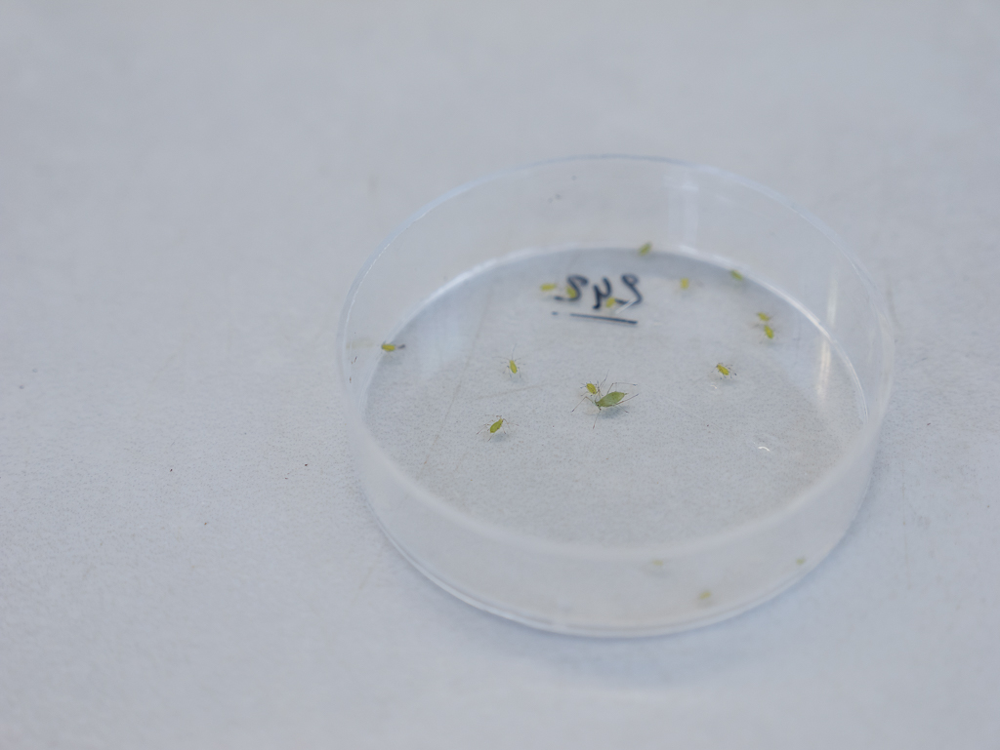
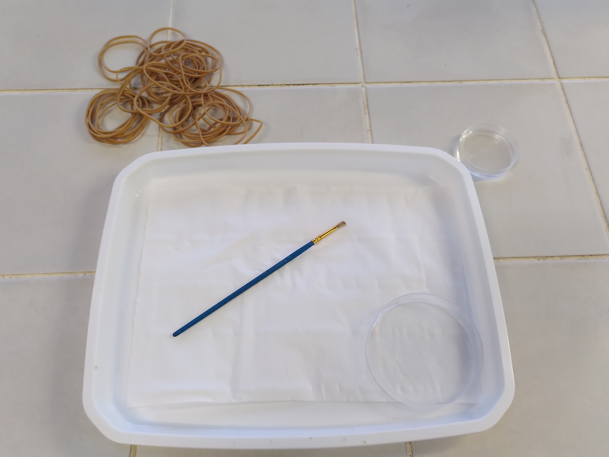

# Fecundity test protocol

## Overview

This protocol aims to measure the number of offspring from one L1-G2 aphid apterous individual.  

The protocol is schematized below:  

The same protocol applies to _Acyrthosiphon pisum_. 

## Checklist for each step 

### 01: faba bean plants for aphid rearing 

- [ ] Sow faba bean plants (universal biotype host, Castel genotype) in 7x7x8 cm pots in 56 x 35 cm trays.  
- [ ] Place in growth chamber at 18°C for 10 days, 16D:8N photoperiod.  
- [ ] Water plants from the bottom by adding ~ 3-4 liters of tap water until the top of tray. 
- [ ] Keep the plants growing for at least 10 days up to 15 days.   
- [ ] If plants get too big (BBCH >14), keep at 4°C. 

### 02: faba or pea plants for experiment 

- [ ] Prepare sowing plan (e.g. completely randomized block design).  
- [ ] Place at 18°C and 16D:8N photoperiod for 10 days. 
- [ ] Prepare plant genotype labels and tray labels (experiment number and block identifier).  
- [ ] Sow the plants (usually a Monday, week 1).  
- [ ] Check plant water status on Friday (week 1).
- [ ] Use the plants for the experiment after 10 days (BBCH scale: 9 to 11).

## 03: G1 generation production 

- [ ] Place 1 to 3 aphid adults (G0) per faba bean plant.  
- [ ] Place infested plants at 18°C for 24h, 16D:8N photoperiod.  
- [ ] Remove adults after 24h.  
- [ ] Place infested plants with L1-G1 at 18°C and 16D:8N photoperiod for 15 days. 
- [ ] Water plants each Friday before the weekend. 

## 04: G2 generation production 

- [ ] Place 5 to 8 aphid adults (G1) per faba bean plant.  
- [ ] Place infested plants at 18°C 16D:8N photoperiod for 24h.    
- [ ] Collect G2-L1 larvae for the experiment.  

## 05: L1-G2 installation

**Before the experiment**  

- [ ] Prepare plastic bags (punch holes) and tags beforehand. Tag should indicate the plant genotype, plant individual number, aphid clone used.   
- [ ] Sort plastic bags+tags so that they match the plant ordering on each tray.  
- [ ] Place one stake in each pot (helps to keep the plastic bag straight).  

**On the day of the experiment**
- [ ] Prepare white plastic trays with petri dishes (one for the water, one to place the plant) with brush.  
- [ ] Get plants and aphids.  
- [ ] Randomize plant again (following the sowing plan).  

## 06: Counting the offspring

**Before the experiment** 

- [ ] Prepare the counting paper sheet for each tray. 

**On the day of the experiment** 
- [ ] Prepare white plastic trays with petri dishes (one for the water, one to place the plant) with brush.  
- [ ] Get rid of aphids and plants.  

# Pictures

  

Collecting aphids:  

  

  

White plastic tray:   
  

