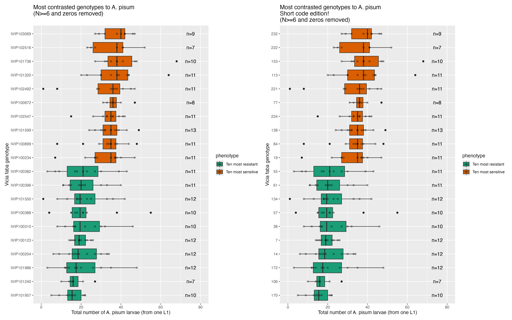
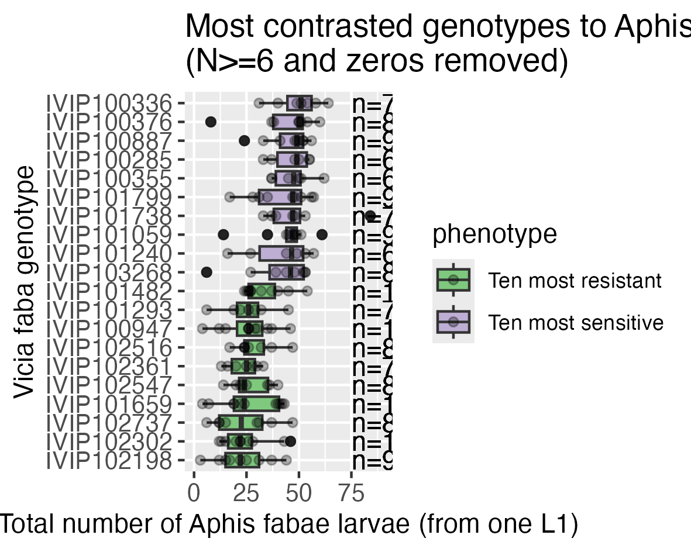
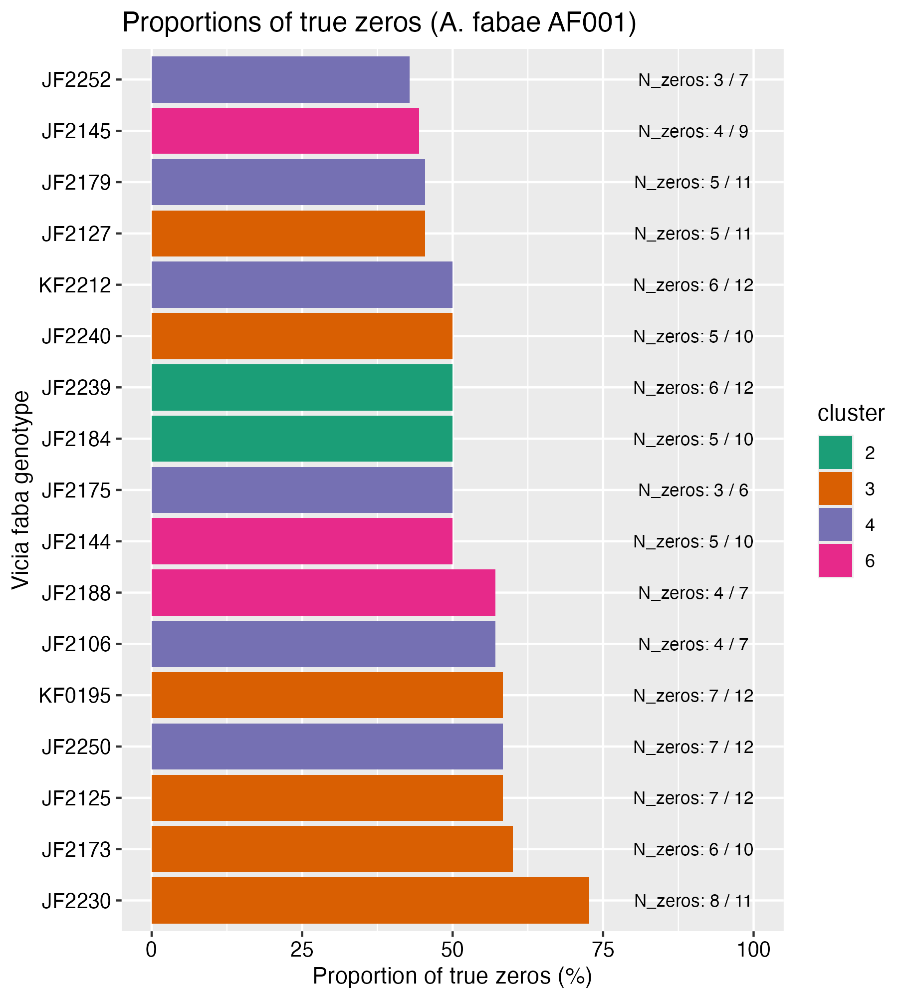
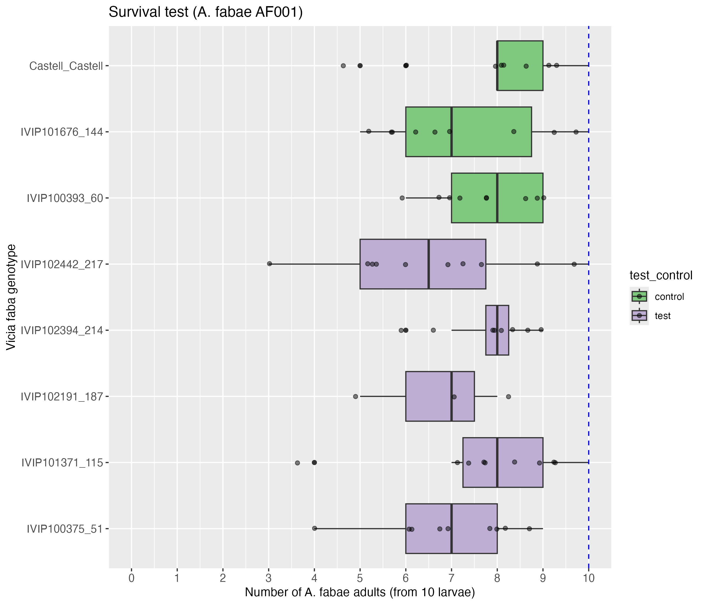

# Faba bean resistance to aphids
<!-- ALL-CONTRIBUTORS-BADGE:START - Do not remove or modify this section -->

<!-- ALL-CONTRIBUTORS-BADGE:END -->

<!-- MarkdownTOC levels="1,2,3" autolink="true" -->

- [Summary](#summary)
- [Fecundity test results on the 251 faba genotypes](#fecundity-test-results-on-the-251-faba-genotypes)
  - [Results for Acyrthosiphon pisum P123](#results-for-acyrthosiphon-pisum-p123)
  - [Results for Aphis fabae AF001](#results-for-aphis-fabae-af001)
    - [Analysis 1 \("quantitative robust"\): N>=6 and no zeros](#analysis-1-quantitative-robust-n6-and-no-zeros)
    - [Analysis 02 \("qualitative zeros"\): N>=6 and proportions of zeros](#analysis-02-qualitative-zeros-n6-and-proportions-of-zeros)
- [Confirmation of the most 20 contrasted genotypes for A. pisum](#confirmation-of-the-most-20-contrasted-genotypes-for-a-pisum)
  - [10vs10 A. pisum: P2-XP006 and P2-XP008](#10vs10-a-pisum-p2-xp006-and-p2-xp008)
  - [5vs5 A. pisum: P2-XP010](#5vs5-a-pisum-p2-xp010)
- [Confirmation of the most 20 contrasted genotypes for A. fabae](#confirmation-of-the-most-20-contrasted-genotypes-for-a-fabae)
  - [10vs10 A. fabae: P2-XP007](#10vs10-a-fabae-p2-xp007)
  - [5vs5 A. fabae: P2-XP009](#5vs5-a-fabae-p2-xp009)
- [Useful links](#useful-links)
- [References](#references)
- [Contributors ✨](#contributors-%E2%9C%A8)

<!-- /MarkdownTOC -->

# Summary 

Within the SPECIFICS project (PIA3 Programme de Recherche Prioritaire "Cultiver et Protéger Autrement" SPECIFICS), a collection of 251 genotypes of _Vicia faba_ (faba bean) were phenotyped for their resistance to _Acyrthosiphon pisum_ and _Aphis fabae_.

Resistance is estimated by measuring the offspring number obtained after 15 days at 18°C from one single L1 24h larvae of A. pisum or A. fabae. The protocol can be found in [`03.protocols/ 01.aphid_fecundity_test/`](03.protocols/01.aphid_fecundity_test).

These results will be used to conduct a GWAS analysis on the collection of exome-sequenced faba bean genotypes (Burstin et al. 2021).
The list of faba genotypes can be found in [`00.info/02.genetic_structure_jonathan_dijon/faba_bean_ivip_and_genetic_cluster.csv`](00.info/02.genetic_structure_jonathan_dijon/faba_bean_ivip_and_genetic_cluster.csv).  

# Fecundity test results on the 251 faba genotypes 

This large screen was performed from 2022 to April 2024 to test the resistance of faba bean genotypes to the pea aphid (_A. pisum_) and to the black bean aphid (_A. fabae_). 

## Results for Acyrthosiphon pisum P123

**Analysis 1** ("quantitative robust"): N>=6 and 1 adult alive.

Criteria:    
- Only genotypes with more than 6 replicates are kept.  
- Only measures where 1 adult is alive are kept.   

 

## Results for Aphis fabae AF001

### Analysis 1 ("quantitative robust"): N>=6 and no zeros

Criteria:    
- Only genotypes with more than 6 replicates are kept.  
- Only measures where 1 adult is alive are kept.   

 

### Analysis 02 ("qualitative zeros"): N>=6 and proportions of zeros

Criteria/method:
- Only genotypes with more than 6 replicates are kept.  
- The proportion of zeros from the total number of measurements is calculated.

It is clear from this plot that some genotypes have a lot of non-surviving larvae (median number is around 10-20% of dying larvae), especially these 5 genotypes:    
- JF2230  
- JF2173  
- JF2125  
- JF2250  
- KF0195

A follow-up experiment was performed (i.e. P2-XP005) with additional controls. The faba bean genotype (Castell) used to rear all aphids in the lab was used as a positive control (high larvae survival rate) and two genotypes on which all L1 installations of _A. fabae_ larvae succeeded were used.   

 

Conclusion: 

# Confirmation of the most 20 contrasted genotypes for A. pisum

Genotypes that were the most partially resistant and sensitive were isolated to be tested within the same experiment (to get rid of the batch effect) with the same aphid clone. 

## 10vs10 A. pisum: P2-XP006 and P2-XP008

10 genotypes partially resistant and 10 genotypes sensitive. 

[FIXME] Add plots of the 10vs10 experiment (P2-XP006 and P2-XP008)

## 5vs5 A. pisum: P2-XP010

5 genotypes partially resistant and 5 genotypes sensitive. 

[FIXME] Add plots of the 5vs5 experiment

# Confirmation of the most 20 contrasted genotypes for A. fabae

## 10vs10 A. fabae: P2-XP007

10 genotypes partially resistant and 10 genotypes sensitive. 

[FIXME] Add plots of the 10vs10 experiment (P2-XP007)

## 5vs5 A. fabae: P2-XP009

5 genotypes partially resistant and 5 genotypes sensitive. 

[FIXME] Add plots of the 5vs5 experiment for Aphis fabae. 

# Useful links

[FAQ on Generalized Linear Mixed Models](https://bbolker.github.io/mixedmodels-misc/glmmFAQ.html#introduction)  

[Tutorial on lme4 model](https://www.rensvandeschoot.com/tutorials/lme4/)

# References

**Faba bean collection:**     
- Judith Burstin, Komlan Avia, Estefania Carillo-Perdomo, Christophe Lecomte, Sana Beji, et al. PeaMUST (Pea MultiStress Tolerance), a multidisciplinary French project uniting researchers, plant breeders, and the food industry. Legume Science, 2021, 3 (3), 10.1002/leg3.108. [hal-03671280](https://hal.inrae.fr/hal-03671280v1)

# Contributors ✨

Thanks goes to these wonderful people ([emoji key](https://allcontributors.org/docs/en/emoji-key)):

<!-- ALL-CONTRIBUTORS-LIST:START - Do not remove or modify this section -->
<!-- prettier-ignore-start -->
<!-- markdownlint-disable -->
<table>
  <tbody>
    <tr>
all-contributors/add-manlebihan
      <td align="center" valign="top" width="14.28%"><a href="https://github.com/manlebihan"> <b>Manon Le Bihan</b></a> <a href="#design-manlebihan" title="Design">🎨</a> <a href="#data-manlebihan" title="Data">🔣</a></td>
      <td align="center" valign="top" width="14.28%"><a href="https://github.com/maiwennlefloch"> <b>Maïwenn Le Floch</b></a> <a href="#design-maiwennlefloch" title="Design">🎨</a> <a href="#data-maiwennlefloch" title="Data">🔣</a></td>
    </tr>
  </tbody>
</table>

<!-- markdownlint-restore -->
<!-- prettier-ignore-end -->

<!-- ALL-CONTRIBUTORS-LIST:END -->

This project follows the [all-contributors](https://github.com/all-contributors/all-contributors) specification. Contributions of any kind welcome!

