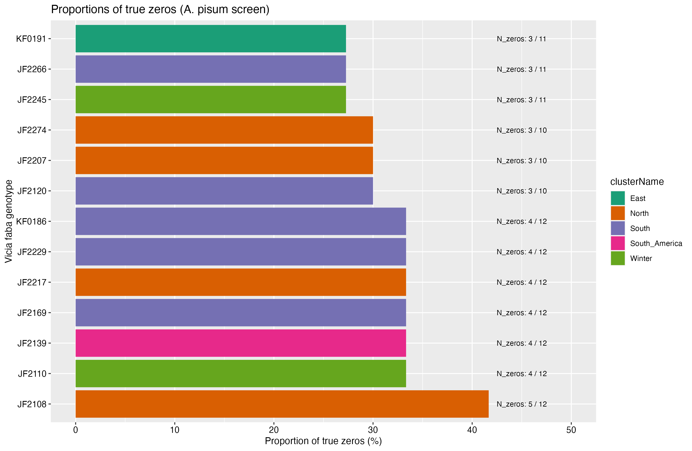
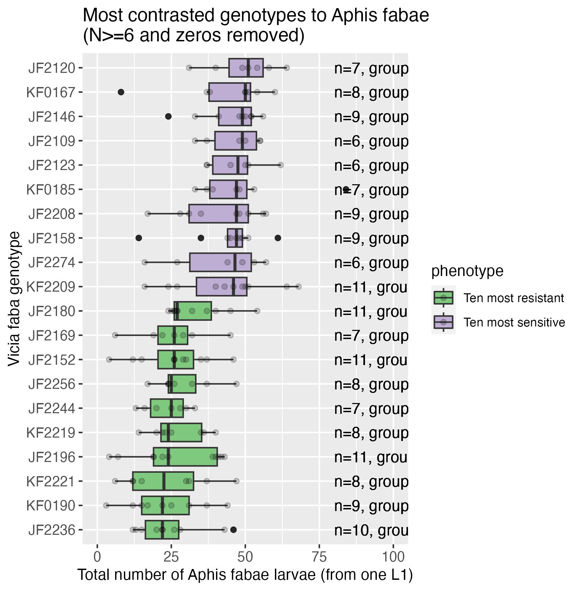
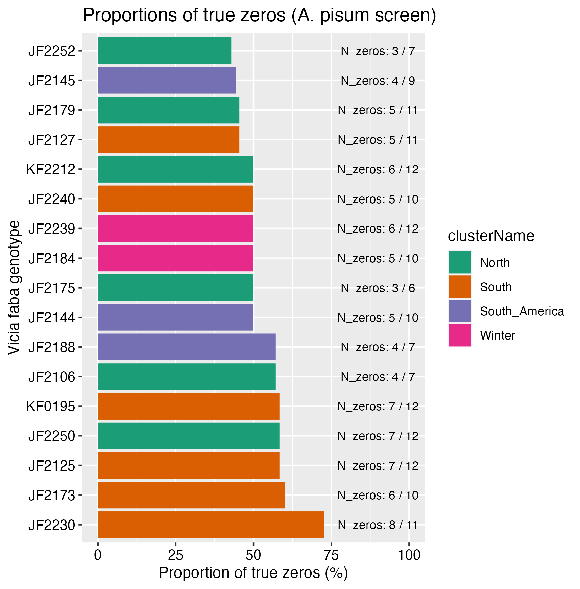
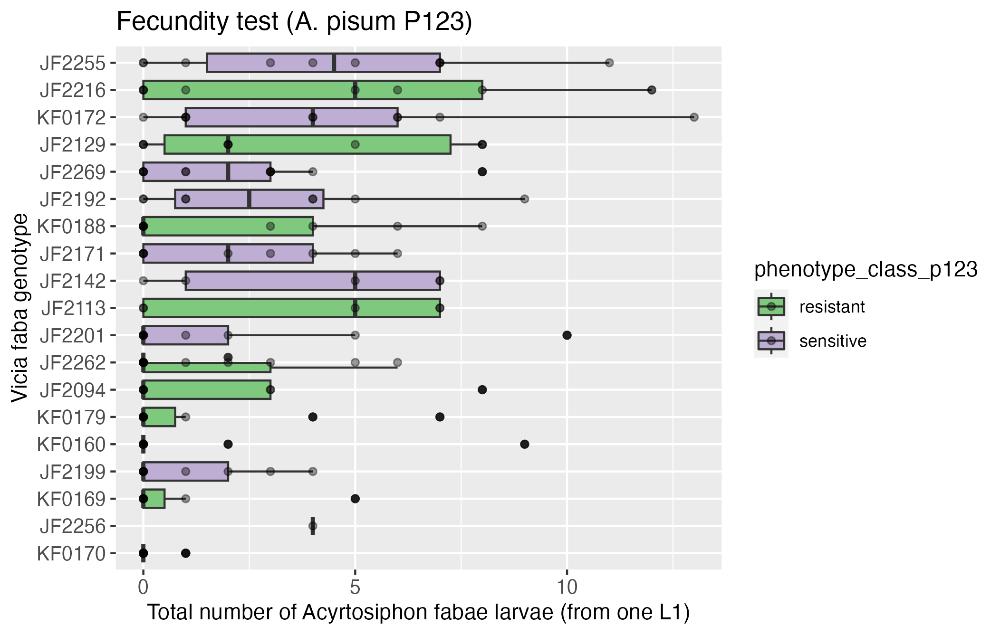
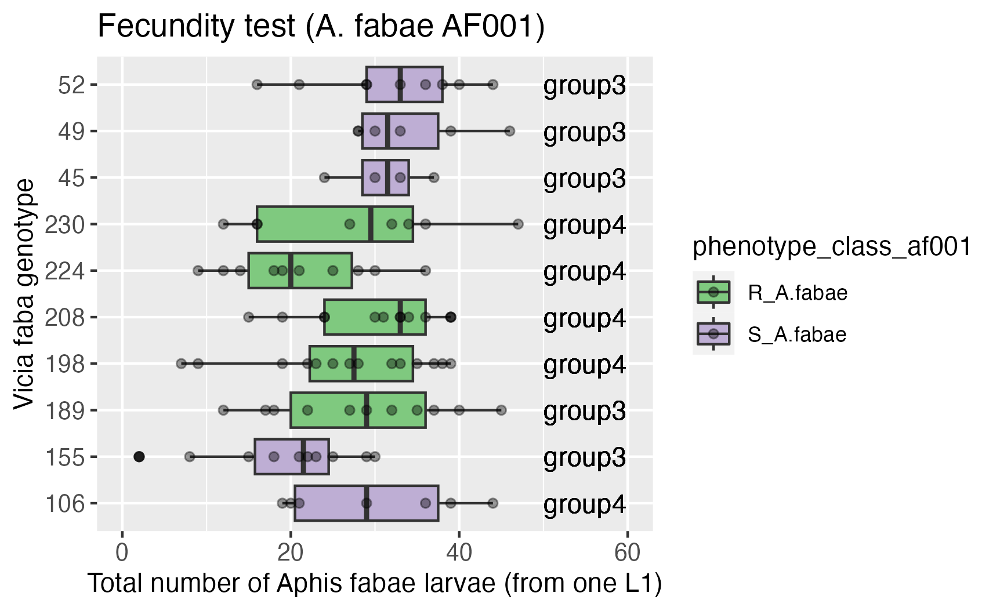

# Faba bean resistance to aphids
<!-- ALL-CONTRIBUTORS-BADGE:START - Do not remove or modify this section -->

<!-- ALL-CONTRIBUTORS-BADGE:END -->

<!-- MarkdownTOC levels="1,2,3" autolink="true" -->

- [Summary](#summary)
- [Screen on the 251 faba genotypes \(2022-2024\)](#screen-on-the-251-faba-genotypes-2022-2024)
- [Results for Acyrthosiphon pisum P123](#results-for-acyrthosiphon-pisum-p123)
	- [Analysis 1 \("quantitative robust"\): N>=6 and no zeros](#analysis-1-quantitative-robust-n6-and-no-zeros)
	- [Analysis 02 \("qualitative zeros"\): N>=6 and proportions of zeros](#analysis-02-qualitative-zeros-n6-and-proportions-of-zeros)
- [Results for Aphis fabae AF001](#results-for-aphis-fabae-af001)
	- [Analysis 1 \("quantitative robust"\): N>=6 and no zeros](#analysis-1-quantitative-robust-n6-and-no-zeros-1)
	- [Analysis 02 \("qualitative zeros"\): N>=6 and proportions of zeros](#analysis-02-qualitative-zeros-n6-and-proportions-of-zeros-1)
- [Confirmation of the most 20 contrasted genotypes](#confirmation-of-the-most-20-contrasted-genotypes)
	- [P2-XP001 Vicia faba vs A. pisum P123](#p2-xp001-vicia-faba-vs-a-pisum-p123)
	- [P2-XP002 Vicia faba vs A. fabae AF001](#p2-xp002-vicia-faba-vs-a-fabae-af001)
- [Useful links](#useful-links)
- [Contributors ✨](#contributors-%E2%9C%A8)

<!-- /MarkdownTOC -->

## Summary

Within the SPECIFICS project (PIA3 Programme de Recherche Prioritaire "Cultiver et Protéger Autrement" SPECIFICS), a collection of 251 genotypes of _Vicia faba_ (faba bean) were phenotyped for their resistance to _Acyrthosiphon pisum_ and _Aphis fabae_.

Resistance is estimated by measuring the offspring number obtained after 15 days at 18°C from one single L1 24h larvae of A. pisum or A. fabae.   

These results will be used to conduct a GWAS analysis on the collection of the 259 exome-sequenced faba bean genotypes.

The list of faba genotypes can be found in "01.data/03.genetic_structure_jonathan_dijon/faba_bean_ivip_ids.csv".

# Screen on the 251 faba genotypes (2022-2024)

## Results for Acyrthosiphon pisum P123

### Analysis 1 ("quantitative robust"): N>=6 and no zeros

Criteria:
- Only genotypes with more than 6 replicates are kept.  
- When total number of larvae is equal to 0, the row is removed and value is discarded. 

 

### Analysis 02 ("qualitative zeros"): N>=6 and proportions of zeros

Criteria/method:
- Only genotypes with more than 6 replicates are kept.  
- The proportion of zeros from the total number of measurements is calculated.

 

## Results for Aphis fabae AF001

### Analysis 1 ("quantitative robust"): N>=6 and no zeros

Criteria:  
- Only genotypes with more than 6 replicates are kept.    
- When total number of larvae is equal to 0, the row is removed and value is discarded.   

 

### Analysis 02 ("qualitative zeros"): N>=6 and proportions of zeros

Criteria/method:
- Only genotypes with more than 6 replicates are kept.  
- The proportion of zeros from the total number of measurements is calculated.

It is clear from this plot that some genotypes have a lot of non-surviving larvae (median number is around 10-20% of dying larvae), especially these 5 genotypes:    
- JF2230  
- JF2173  
- JF2125  
- JF2250  
- KF0195

# Confirmation of the most 20 contrasted genotypes

Genotypes that were the most resistant and sensitive were isolated to be tested within the same experiment (to get rid of the batch effect) with the same aphid clone. 

### P2-XP001 Vicia faba vs A. pisum P123

Issue with the growth chamber temperature (set at 18 degrees instead of 20). 

### P2-XP002 Vicia faba vs A. fabae AF001

# Useful links

[FAQ on Generalized Linear Mixed Models](https://bbolker.github.io/mixedmodels-misc/glmmFAQ.html#introduction)  

[Tutorial on lme4 model](https://www.rensvandeschoot.com/tutorials/lme4/)

## Contributors ✨

Thanks goes to these wonderful people ([emoji key](https://allcontributors.org/docs/en/emoji-key)):

<!-- ALL-CONTRIBUTORS-LIST:START - Do not remove or modify this section -->
<!-- prettier-ignore-start -->
<!-- markdownlint-disable -->
<table>
  <tbody>
    <tr>
all-contributors/add-manlebihan
      <td align="center" valign="top" width="14.28%"><a href="https://github.com/manlebihan"> <b>Manon Le Bihan</b></a> <a href="#design-manlebihan" title="Design">🎨</a> <a href="#data-manlebihan" title="Data">🔣</a></td>
      <td align="center" valign="top" width="14.28%"><a href="https://github.com/maiwennlefloch"> <b>Maïwenn Le Floch</b></a> <a href="#design-maiwennlefloch" title="Design">🎨</a> <a href="#data-maiwennlefloch" title="Data">🔣</a></td>
    </tr>
  </tbody>
</table>

<!-- markdownlint-restore -->
<!-- prettier-ignore-end -->

<!-- ALL-CONTRIBUTORS-LIST:END -->

This project follows the [all-contributors](https://github.com/all-contributors/all-contributors) specification. Contributions of any kind welcome!

